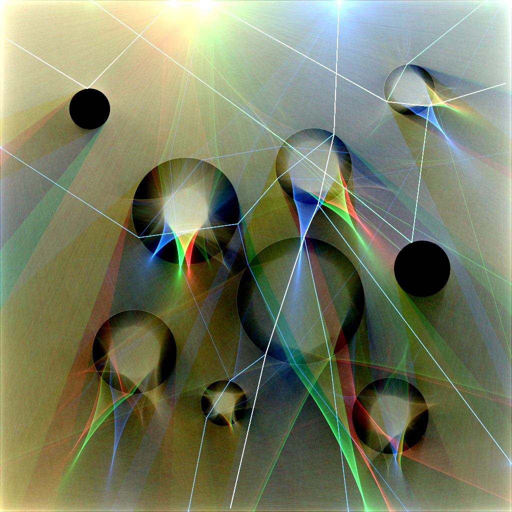
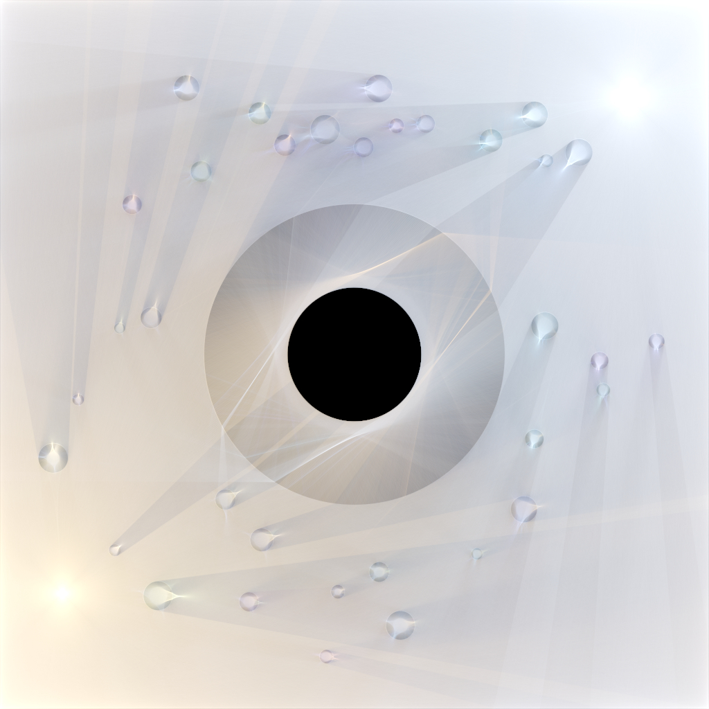
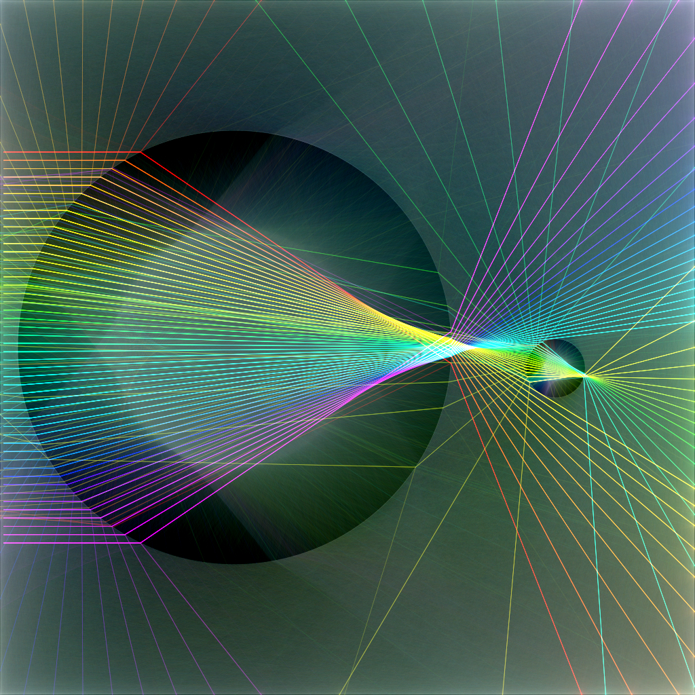

# 2D Ray Tracer

A 2D forward ray tracer written in C. Here's a video of it rendering a scene!

https://github.com/user-attachments/assets/906e5348-5618-46f2-b69f-3b45a2028f48

Here are some other scenes it has rendered:

<table>
  <tr>
    <td></td>
    <td></td>
  </tr>
  <tr>
    <td></td>
    <td></td>
  </tr>
</table>

For the full list of scenes, check out the [renderings](renderings/) folder.

The scene description files can be found in [scenes](scenes/).

## How It Works

1. For each light source in the array, light rays from the light source are simulated one by one.
2. Rays are propagated through the scene until they hit an object (or one of the 4 walls).
3. Depending on the properties of the object a ray hits, it will either reflect, refract, or scatter, which determines its new direction. The ray's color is affected by the color of the object it hits. This new ray is then propagated through the scene, until the max recursion depth is reached.

## How to Compile

```bash
./compile_GUI.sh
```

Or use `./compile.sh`, which requires commenting out `#define USE_GL` in `light2D.c`.

## Rendering the Scenes

Then, you can render the scenes in [scenes](scenes/) using the following commands:

```bash
./light2D 3 0 0.02 0.02 5000000 scenes/01_coffee_cup_caustic.txt
```

```bash
./light2D 8 0 0.02 0.02 1500000 scenes/02_sunflower_galaxy.txt
```

```bash
./light2D 10 0 0.04 0.02 500000 scenes/03_laser_pinball.txt
```

```bash
./light2D 8 0 0.02 0.02 1000000 scenes/04_sunlit_raindrops.txt
```

```bash
./light2D 6 0 0.05 0.02 2000000 scenes/05_stained_glass_honeycomb.txt
```

```bash
./light2D 8 0 0.02 0.02 2000000 scenes/06_black_hole.txt
```

```bash
./light2D 4 0 0.08 0.02 3000000 scenes/07_rgb_shadow_crown.txt
```

```bash
./light2D 10 0 0.02 0.02 500000 scenes/08_rainbow_laser_harp.txt
```

You can also create your own scene file and render it with the appropriate parameters. Run `./light2D` after compiling to learn what each parameter does.
